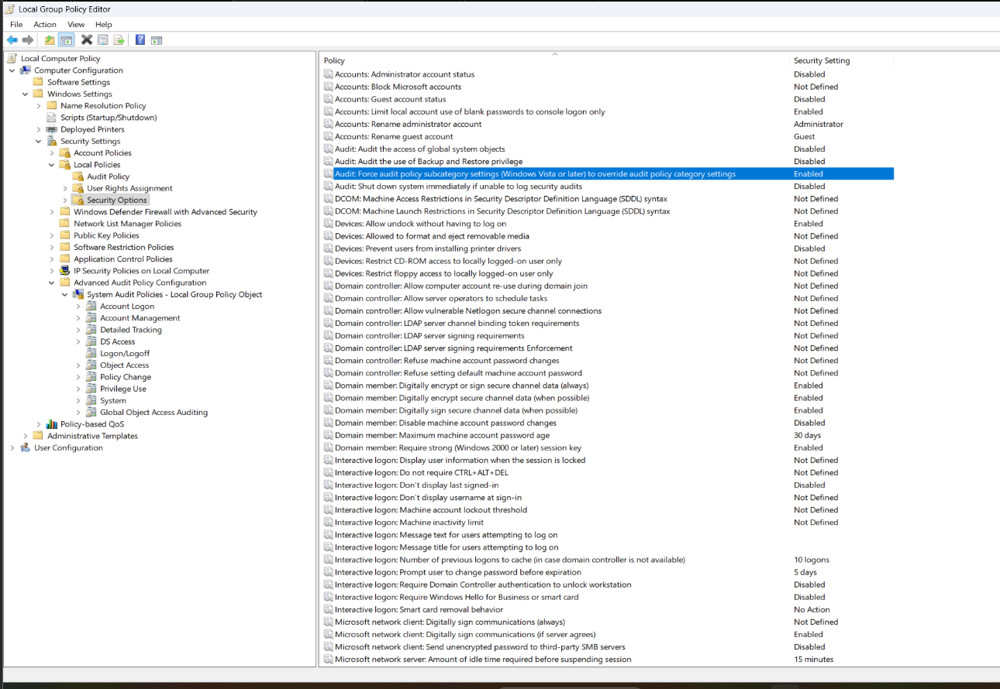
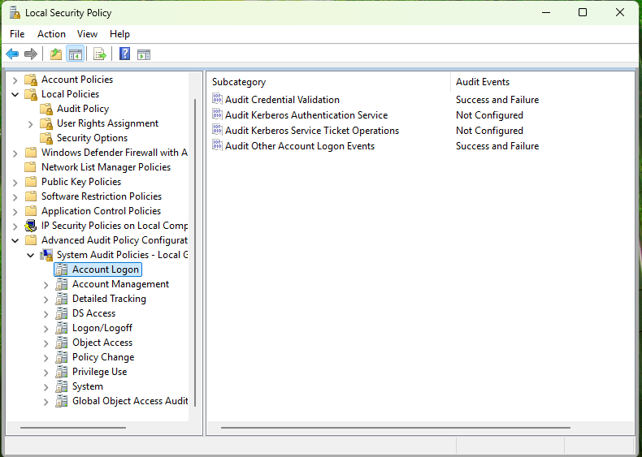
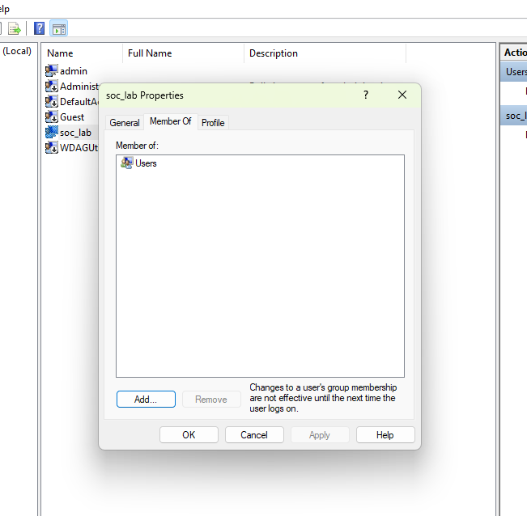
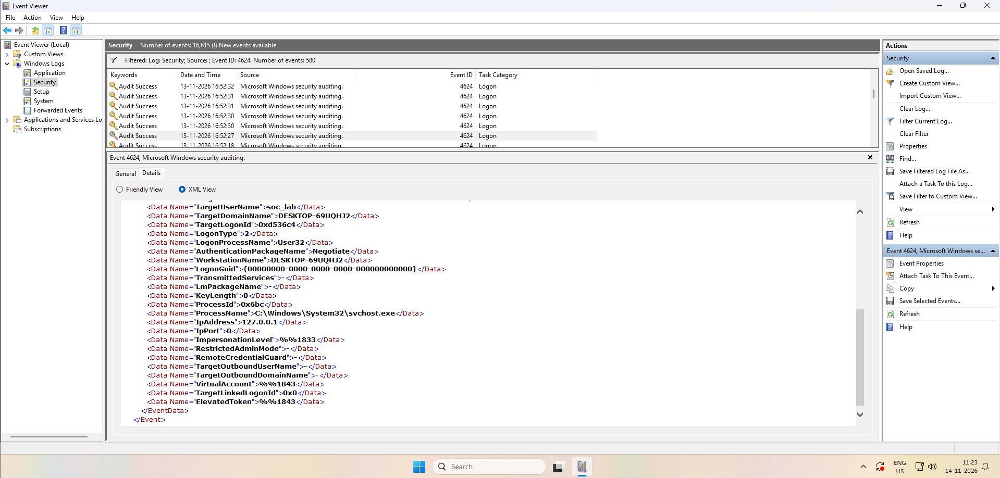
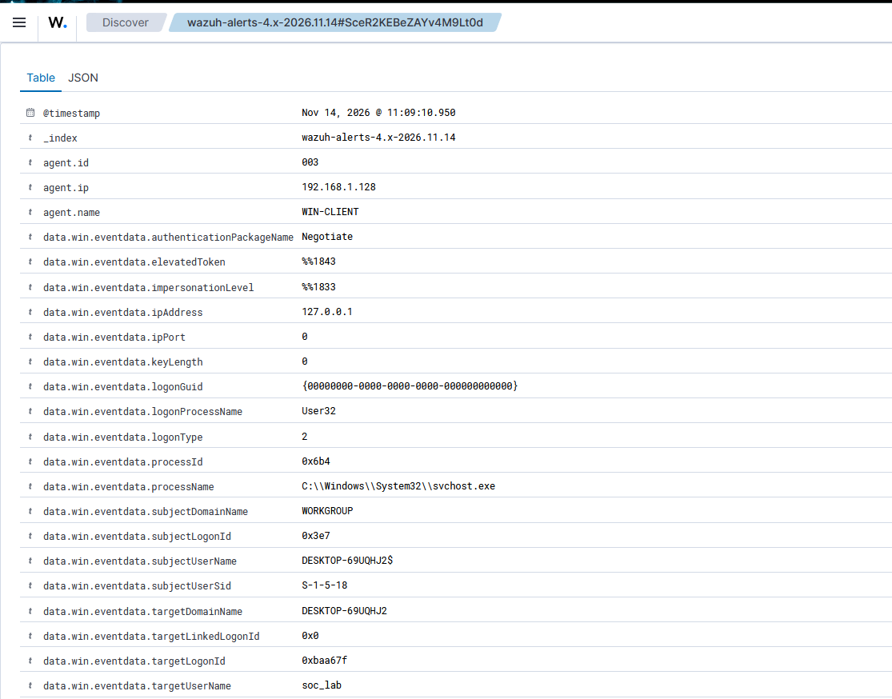
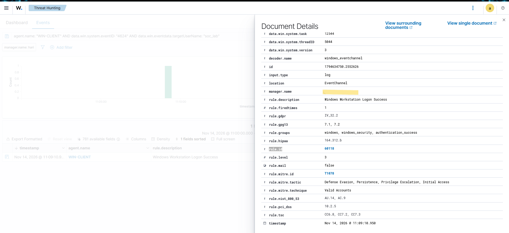

## Evidence and Investigation Results

### 1. Windows Audit Policy Configuration

The Windows audit policy subcategory override was enabled to ensure advanced audit policies take precedence.

### 2. Account Logon Auditing

Credential Validation and Other Account Logon Events were configured for Success and Failure auditing.

### 3. Test Account Configuration

The `soc_lab` account was verified as a standard user belonging to the Users group.

### 4. Windows Successful Authentication Event

Windows Event ID 4624 was generated and investigated. The event confirmed a successful interactive login.

### 5. Wazuh Event Collection

The corresponding Windows authentication event was successfully collected and indexed by Wazuh.

### 6. Wazuh Detection Rule

Wazuh matched the event against Rule ID 60118, identifying it as a Windows workstation logon success.

